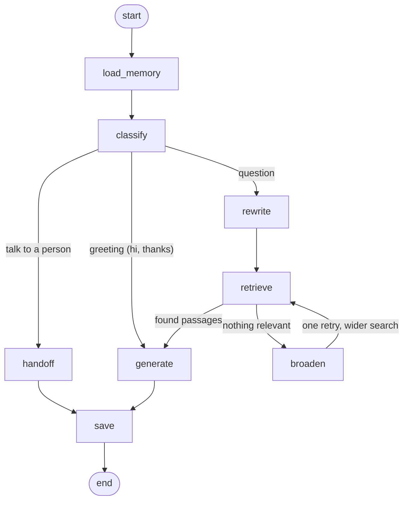

# Chat workflow (LangGraph)

Every message runs through this graph, built in `app/graph/graph.py`. GitHub and VS Code render the diagram.



| Node | File | What it does | Calls a model? |
|---|---|---|---|
| `load_memory` | `nodes/memory.py` | Last 4 question/answer pairs + running summary from Postgres | no |
| `classify` | `nodes/router.py` | Picks the route with simple rules: handoff, greeting or question | no |
| `rewrite` | `nodes/retrieval.py` | Follow-ups and Urdu become a standalone English search query | only when needed |
| `retrieve` | `nodes/retrieval.py` | Hybrid search (vector + keyword), rerank, similarity cutoff | no |
| `broaden` | `nodes/retrieval.py` | Nothing found: rephrase and search again with a looser cutoff (once) | yes (small) |
| `generate` | `nodes/generation.py` | the model answers from the passages, may call `lookup_order`, streams words | yes |
| `handoff` | `nodes/handoff.py` | Creates a support ticket, replies without an LLM | no |
| `save` | `nodes/memory.py` | Stores both messages, updates the summary in the background | in background |

**State** (`ChatState` in `app/graph/state.py`) is the shared notebook every node reads and updates:
question, history, route, search query, retrieved passages, answer, token usage, tools used.

**Live events**: nodes send `step`, `meta`, `tool`, `delta` and `done` events through LangGraph's
custom stream. Flask forwards them to the browser (Server-Sent Events), and the chat's trace
shows the real step the graph is on.

Print the graph straight from the code:

```bash
python -m app.graph.graph
```

## Where things live

```
app/graph/
├── state.py        ChatState
├── deps.py         what nodes get from outside (knowledge base, model, repositories)
├── events.py       the live events sent to the browser
├── nodes/          one file per job; each node is  node(state, deps) -> changes
├── edges.py        the two decisions (after classify, after retrieve)
├── graph.py        wires nodes + edges together
└── studio.py       entry point for LangGraph Studio (langgraph.json)
```

Add a step: write a function in `nodes/`, add it to `NODES` and connect it in `graph.py`.
Test it alone by calling it with a state and fake deps (see `tests/test_graph_routes.py`).

## LangGraph Studio (visual debugger)

```bash
pip install "langgraph-cli[inmem]"
langgraph dev        # from services/support-ai; needs the database and models like the API
```
